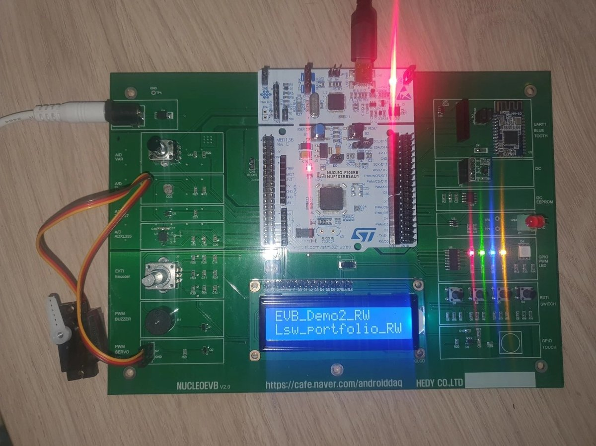
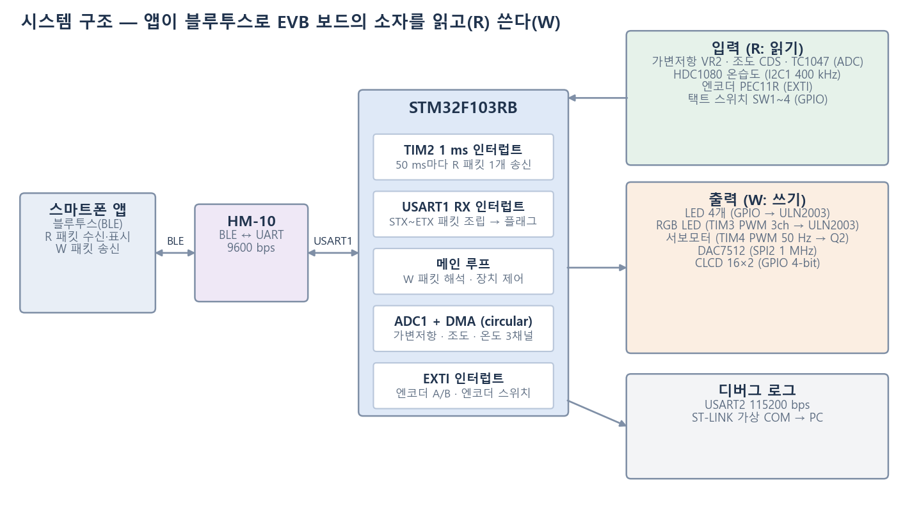
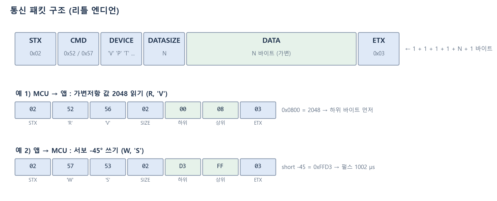
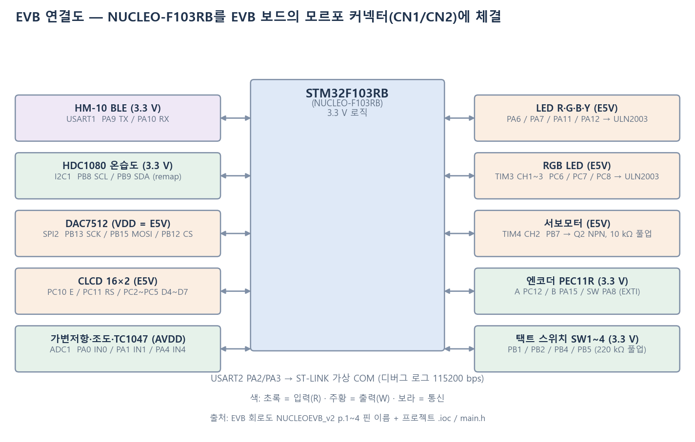

# STM32F103RB EVB 블루투스 양방향 제어 (R/W 프로토콜)

**스마트폰 앱 ↔ HM-10(BLE) ↔ USART1로 직접 설계한 바이너리 패킷을 주고받아, EVB 보드의 센서 7종을 읽고(R) 출력 소자 6종을 제어(W)하는 인터럽트 기반 펌웨어**

<!--
대표 사진·영상 자리 (사진을 받으면 아래 표로 교체)
<table><tr>
<td width="50%"></td>
<td width="50%"> 앱에서 서보·RGB LED 제어 → 보드 반응</td>
</tr></table>
-->

| 읽기 장치 (R) | 쓰기 장치 (W) | 사용한 인터럽트 | Flash / RAM |
|:---:|:---:|:---:|:---:|
| **7종** | **6종** | **UART · TIM · EXTI · DMA** | **37 % / 16 %** |

---

## 시스템 구조

TIM2 1 ms 인터럽트 → 50 ms마다 R 패킷 1개 송신 (장치 7개 순환, 장치당 350 ms) · USART1 수신 인터럽트로 W 패킷 조립 → 메인 루프에서 해석

→ 개발 목적, 실행 흐름, 모듈 구성: [01_system_architecture.md](docs/01_system_architecture.md)

## 통신 프로토콜

| DEVICE | 장치 | R/W | 크기 | 형식 |
|:---:|---|:---:|:---:|---|
| `V` / `P` | 가변저항 / 조도 | R | 2 | unsigned short |
| `T` | TC1047 온도 | R | 4 | float |
| `I` | HDC1080 온습도 | R | 4+1 | float + unsigned char |
| `E` | 엔코더 | R/W | 4 | int |
| `R` / `L` | 택트 스위치 / LED | R · R/W | 4 | 1바이트 × 4 |
| `S` | 서보 (−90~90°) | W | 2 | short |
| `D` | DAC (0~4095) | W | 2 | unsigned short |
| `M` | RGB LED | W | 3 | 0~255 × 3 |
| `1` / `2` | CLCD 1줄 / 2줄 | W | 16 | 문자열 |

→ 패킷 조립·해석 코드, 장치별 변환식: [04_firmware_implementation.md](docs/04_firmware_implementation.md)

## 하드웨어

<!-- 사진 자리: EVB 보드 전체 사진 + 주요 소자 클로즈업 (CLCD, 서보, RGB LED, HM-10) -->

**3.3 V MCU로 5 V 소자 구동 — 데이터시트로 확인한 것**

| 소자 (전원) | 연결 | 확인 내용 |
|---|---|---|
| CLCD (5 V) | GPIO 4-bit | 입력 High 기준 2.2 V < 3.3 V, R/W GND 고정 → MCU로 5 V 역입력 없음 |
| DAC7512 (5 V) | SPI2 | 입력 High 기준 2.4 V < 3.3 V, 하강 에지 샘플링 = SPI Mode 1 |
| 서보 (5 V) | TIM4 → NPN Q2 + 10 kΩ 풀업 | 트랜지스터가 신호를 반전 → **TIM 출력 극성 LOW로 보정** |
| LED · RGB (5 V) | GPIO / TIM3 → ULN2003 | 싱크 드라이버, 핀 High = 켜짐 |

→ 핀 할당, 소자별 회로, 용어 풀이: [02_hardware.md](docs/02_hardware.md)

## 동작 데모

<!--
영상 자리 (받으면 GIF로 변환해 103RB 프로젝트처럼 배치)
① 앱 R 화면: 가변저항을 돌리면 앱 값이 바뀜 (보드 + 앱 동시 촬영 또는 시간 맞춰 합침)
② 앱 W: 서보 −90° / 0° / 90°
③ 앱 W: RGB LED 색 변경, LED 4개 켜기/끄기
④ 앱 W: CLCD 문자열 표시
⑤ Tera Term: W 패킷 16진수 덤프 + STX_OK ~ ETX_OK 로그
-->

> 데모 영상은 준비 중입니다.

## 리뷰로 찾은 개선점

코드와 데이터시트를 다시 검토해 찾은 이슈입니다 (아직 수정 전).

| 우선순위 | 이슈 | 제안 |
|---|---|---|
| 높음 | ETX 값(0x03)으로 패킷 끝을 판단 → DATA에 0x03이 있으면 잘림 | DATASIZE 기반 상태 머신 |
| 높음 | 수신 버퍼 범위 검사 없음, 해석 중 ISR이 같은 버퍼에 씀 | 범위 검사 + 더블 버퍼 |
| 중간 | DAC 전압 로그가 3.3 V 기준 (실제 기준 = E5V) | 실측값으로 계산 |
| 중간 | HDC1080 히터 켜짐, 매 루프 15 ms blocking 측정 | 히터 끄기, 측정 주기 분리 |

→ 전체 17개 이슈와 근거: [05_troubleshooting.md](docs/05_troubleshooting.md)

## 상세 문서

| 문서 | 내용 |
|---|---|
| [01 시스템 아키텍처](docs/01_system_architecture.md) | 개발 목적, 인터럽트·메인 루프 실행 흐름, 모듈 구성 |
| [02 하드웨어](docs/02_hardware.md) | 용어 풀이, 핀 할당, 소자별 회로, 3.3 V ↔ 5 V 레벨 확인 |
| [03 CubeMX 설정](docs/03_cubemx_configuration.md) | 클럭, ADC+DMA, 타이머 3종, SPI·I2C·UART, NVIC |
| [04 펌웨어 구현](docs/04_firmware_implementation.md) | 프로토콜, R 송신 스케줄, W 수신·해석, 장치별 변환 |
| [05 트러블슈팅](docs/05_troubleshooting.md) | 회로 기반 대응, 리뷰 이슈 17개 |
| [06 테스트 결과](docs/06_testing_and_results.md) | 검증 매트릭스, 계산값, 실측 계획, 리소스 |
