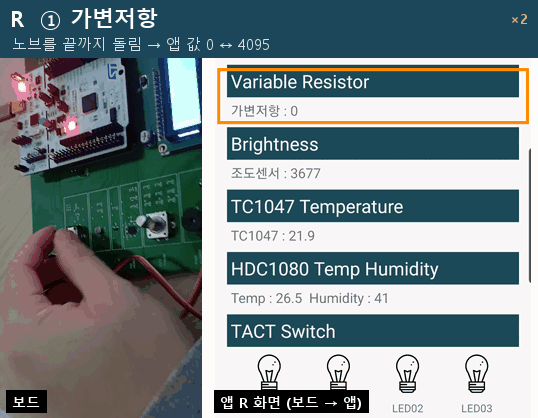
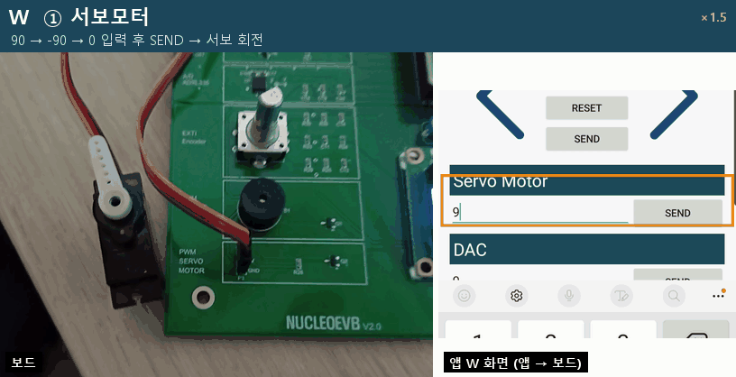
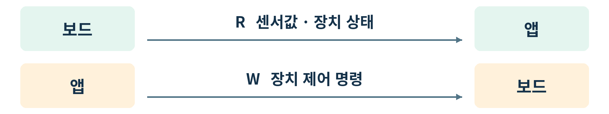
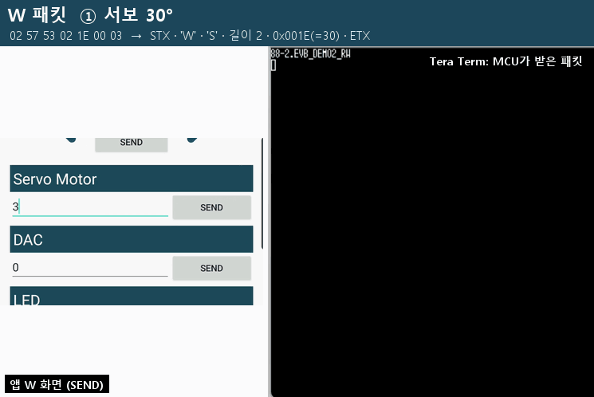

# STM32F103RB EVB 블루투스 양방향 제어 (R/W 프로토콜)

**교재 마지막 장의 '데모2' 과제를 직접 구현한 프로젝트 — 교재가 제공한 통신 프로토콜(STX~ETX 바이너리 패킷)로 스마트폰 앱 ↔ HM-10(BLE) ↔ USART1을 연결해, EVB 보드의 센서 7종을 읽고(R) 출력 소자 6종을 제어(W)하는 인터럽트 기반 펌웨어**

교재 제공: 패킷 형식·장치 문자·데이터 형식(프로토콜 표), EVB 보드 · 직접 구현: 패킷 송수신과 해석, 장치별 제어, 인터럽트·DMA·타이머 구성 (`main.c` USER CODE)

<table>
<tr><td colspan="2"> NUCLEO-F103RB + EVB 보드 — 앱에서 보낸 문자열이 CLCD에 표시되고 LED 4개가 켜진 상태</td></tr>
<tr>
<td width="40%" valign="top"> <b>R</b> (보드 → 앱): 보드 센서를 건드리면 앱 값이 따라 바뀜</td>
<td width="60%" valign="top"> <b>W</b> (앱 → 보드): 앱에서 보낸 값대로 서보·CLCD·RGB LED가 바뀜</td>
</tr>
<tr><td colspan="2" align="center">보드 영상과 앱 화면 녹화를 같은 순간에 맞춰 합침</td></tr>
</table>

| 읽기 장치 (R) | 쓰기 장치 (W) | 사용한 인터럽트 | Flash / RAM |
|:---:|:---:|:---:|:---:|
| **7종** | **6종** | **UART · TIM · EXTI · DMA** | **37 % / 16 %** |

---

## 시스템 구조

TIM2 1 ms 인터럽트 → 50 ms마다 R 패킷 1개 송신 (장치 7개 순환, 장치당 350 ms) · USART1 수신 인터럽트로 W 패킷 조립 → 메인 루프에서 해석

→ 개발 목적, 실행 흐름, 모듈 구성: [01_system_architecture.md](docs/01_system_architecture.md)

## 하드웨어

**3.3 V MCU로 5 V 소자 구동 — 데이터시트로 확인한 것**

| 소자 (전원) | 연결 | 확인 내용 |
|---|---|---|
| CLCD (5 V) | GPIO 4-bit | 입력 High 기준 2.2 V < 3.3 V, R/W GND 고정 → MCU로 5 V 역입력 없음 |
| DAC7512 (5 V) | SPI2 | 입력 High 기준 2.4 V < 3.3 V, 하강 에지 샘플링 = SPI Mode 1 |
| 서보 (5 V) | TIM4 → NPN Q2 + 10 kΩ 풀업 | 트랜지스터가 신호를 반전 → **TIM 출력 극성 LOW로 보정** |
| LED · RGB (5 V) | GPIO / TIM3 → ULN2003 | 싱크 드라이버, 핀 High = 켜짐 |

→ 핀 할당, 소자별 회로, 용어 풀이: [02_hardware.md](docs/02_hardware.md)

## 통신 프로토콜

| DEVICE | 장치 | R/W | 크기 | 형식 |
|:---:|---|:---:|:---:|---|
| `V` / `P` | 가변저항 / 조도 | R | 2 | unsigned short |
| `T` | TC1047 온도 | R | 4 | float |
| `I` | HDC1080 온습도 | R | 4+1 | float + unsigned char |
| `E` | 엔코더 | R/W | 4 | int |
| `R` / `L` | 택트 스위치 / LED | R · R/W | 4 | 1바이트 × 4 |
| `S` | 서보 (−90~90°) | W | 2 | short |
| `D` | DAC (0~4095) | W | 2 | unsigned short |
| `M` | RGB LED | W | 3 | 0~255 × 3 |
| `1` / `2` | CLCD 1줄 / 2줄 | W | 16 | 문자열 |

→ 주변장치 설정(클럭, 타이머, UART, ADC+DMA): [03_cubemx_configuration.md](docs/03_cubemx_configuration.md)

→ 패킷 조립·해석 코드, 장치별 변환식: [04_firmware_implementation.md](docs/04_firmware_implementation.md)

## 동작 데모

### ① R — 보드 → 앱 (센서 7종 중 5종)

 
왼쪽: 실제 동작 · 오른쪽: 같은 시점의 앱 R 화면 (두 녹화를 스위치 누름 순간에 맞춰 합침, 주황 테두리 = 지금 바뀌는 값) 
가변저항 <code>0 ↔ 4095</code> · 조도 가림 약 <code>3500 → 600</code> · TC1047 손가락 <code>22.6 → 25.6</code> °C · HDC1080 손끝 습도 <code>42 → 88</code> % · SW1~SW4 
값은 동작보다 최대 약 1 s 늦게 바뀜: 장치 7개를 50 ms씩 돌아가며 보내 장치당 350 ms 주기 + 센서 자체 반응 시간

### ② W — 앱 → 보드 (서보 · CLCD · RGB LED)

 
왼쪽: 실제 동작 · 오른쪽: 같은 시점의 앱 W 화면 (두 녹화를 서보 SEND 순간에 맞춰 합침) 
서보 <code>90 → −90 → 0</code>° · CLCD <code>test1</code> / <code>test2</code> · 컬러 휠로 RGB LED 색 변경

### ③ W 패킷 — 앱 SEND ↔ MCU가 받은 16진수

 
왼쪽: 앱에서 SEND · 오른쪽: 같은 시점에 MCU가 받은 패킷을 USART2로 출력한 Tera Term 로그 
<code>02 57 53 02 1E 00 03</code> = STX · 'W' · 서보 'S' · 길이 2 · 30(0x001E, 하위 바이트 먼저) · ETX 
CLCD 문자열은 앱이 거꾸로 보냄(<code>70 6F … 61</code>) → 펌웨어가 뒤집어 <code>abcdefghijklmnop</code> 표시

## 리뷰로 찾은 개선점

코드와 데이터시트를 다시 검토해 찾은 이슈입니다. ✅는 보드에서 문제를 겪고 수정한 항목, 나머지는 아직 수정 전입니다.

| 우선순위 | 이슈 | 제안 |
|---|---|---|
| ✅ 수정 | ETX 값(0x03)으로 패킷 끝을 판단 → DATA에 0x03이 있으면 잘림 (CLCD 미표시 문제로 발견) | DATASIZE로 ETX 위치 계산 후 검증 ([05 문서 1-1절](docs/05_troubleshooting.md)) |
| ✅ 수정 | 해석 중 ISR이 같은 버퍼에 씀 → 연속 패킷이 깨짐 (RGB 제어 불가 문제로 발견) | 해석이 끝난 뒤 수신 재개 ([05 문서 1-2절](docs/05_troubleshooting.md)) |
| 중간 | DAC 전압 로그가 3.3 V 기준 (실제 기준 = E5V) | 실측값으로 계산 |
| 중간 | HDC1080 히터 켜짐, 매 루프 15 ms blocking 측정 | 히터 끄기, 측정 주기 분리 |

→ 전체 17개 이슈와 근거: [05_troubleshooting.md](docs/05_troubleshooting.md)

## 상세 문서

| 문서 | 내용 |
|---|---|
| [01 시스템 아키텍처](docs/01_system_architecture.md) | 개발 목적, 인터럽트·메인 루프 실행 흐름, 모듈 구성 |
| [02 하드웨어](docs/02_hardware.md) | 용어 풀이, 핀 할당, 소자별 회로, 3.3 V ↔ 5 V 레벨 확인 |
| [03 CubeMX 설정](docs/03_cubemx_configuration.md) | 클럭, ADC+DMA, 타이머 3종, SPI·I2C·UART, NVIC |
| [04 펌웨어 구현](docs/04_firmware_implementation.md) | 프로토콜, R 송신 스케줄, W 수신·해석, 장치별 변환 |
| [05 트러블슈팅](docs/05_troubleshooting.md) | 회로 기반 대응, 리뷰 이슈 17개 |
| [06 테스트 결과](docs/06_testing_and_results.md) | 검증 매트릭스, 계산값, 실측 계획, 리소스 |
