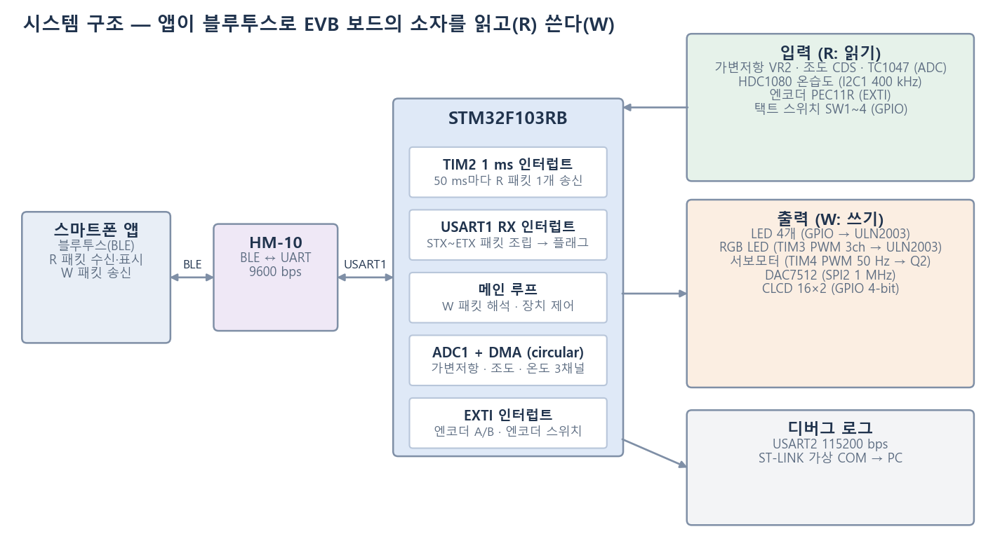

# 01. 시스템 아키텍처

> 파일: [main.c](../Core/Src/main.c), [clcd.c](../Core/Src/clcd.c), [hdc1080.c](../Core/Src/hdc1080.c), [stm32f1xx_it.c](../Core/Src/stm32f1xx_it.c), [stm32f1xx_hal_msp.c](../Core/Src/stm32f1xx_hal_msp.c), [.ioc](../88-2.EVB_DEMO2_RW.ioc)

## 0. 개요

### 0-1. 개발 목적

> **출처:** 교재 마지막 장의 프로젝트 **'데모2'**를 직접 구현했습니다. 통신 프로토콜 표(패킷 형식, 장치 문자, 데이터 형식)와 EVB 보드는 교재에서 제공되었고, 패킷 송수신·해석과 장치 제어, 주변장치 구성은 직접 작성했습니다.

| 목적 | 구현 방식 |
|---|---|
| 스마트폰 앱으로 보드의 센서 값을 **읽고(R)**, 출력 소자를 **쓰는(W)** 양방향 제어 | 블루투스 모듈 HM-10 ↔ USART1, 교재에서 주어진 바이너리 패킷 규격 (STX / CMD / DEVICE / DATASIZE / DATA / ETX)을 구현 |
| 폴링이 아닌 **인터럽트 기반** 구조 | UART 수신 인터럽트, 타이머 인터럽트, 외부 인터럽트(EXTI), ADC DMA |
| 서로 다른 주변장치를 한 MCU에서 동시에 사용 | ADC+DMA, PWM 2종(LED / 서보), SPI(DAC), I2C(온습도), GPIO(CLCD, LED, 스위치) |

### 0-2. 주요 기능

- **R (MCU → 앱)**: 50 ms마다 장치 1개씩 차례로 값을 보냄 (가변저항 → 조도 → 온도 TC1047 → 온습도 HDC1080 → 택트 스위치 → LED 상태 → 엔코더 → 다시 처음). 장치 하나는 350 ms마다 갱신됩니다.
- **W (앱 → MCU)**: 앱이 보낸 패킷의 DEVICE 값에 따라 LED 4개, RGB LED, 서보모터, DAC 출력 전압, CLCD 두 줄, 엔코더 카운트를 바꿈.
- **로컬 입력**: 택트 스위치를 누르면 해당 LED가 토글되고, 엔코더를 돌리면 카운트가 바뀜 (다음 R 패킷에 반영).
- **디버그 로그**: 받은 패킷을 16진수로 USART2(PC)에 출력하고, `STX_OK`, `W_OK`, `DATABYTE_OK`, `ETX_OK`처럼 필드별 확인 결과를 찍음.

### 0-3. 개발 환경

| 항목 | 내용 |
|---|---|
| 보드 | NUCLEO-F103RB를 **EVB 보드**(NUCLEO EVB v2)의 모르포 커넥터 CN1/CN2에 체결 |
| MCU | STM32F103RBT6 (Cortex-M3, Flash 128 KB, RAM 20 KB) |
| 클럭 | HSI/2 × PLL16 = **64 MHz** |
| IDE / 라이브러리 | STM32CubeIDE, STM32Cube HAL (F1) |
| 방식 | 베어메탈 super-loop + 인터럽트 |
| 통신 상대 | 스마트폰 앱 (블루투스 BLE, HM-10 경유) |

## 1. 시스템 구성 요소



| 구성 요소 | 역할 | 인터페이스 | 방향 |
|---|---|---|---|
| HM-10 | 블루투스(BLE) ↔ UART 변환 | USART1, 9600 bps | 양방향 |
| 가변저항 VR2 / 조도 CDS / TC1047 | 아날로그 전압 → 숫자 | ADC1 IN0 / IN1 / IN4 + DMA | 센서 → MCU |
| HDC1080 | 온도·습도 | I2C1, 400 kHz | 센서 → MCU |
| 엔코더 PEC11R | 회전 방향·횟수, 누름 | EXTI (A, B, SW) | 엔코더 → MCU |
| 택트 스위치 SW1~4 | 버튼 입력 | GPIO 입력 | 스위치 → MCU |
| LED R·G·B·Y | 켜기/끄기 | GPIO 출력 → ULN2003 | MCU → LED |
| RGB LED | 색 섞기 (0~255) | TIM3 PWM 3채널 → ULN2003 | MCU → LED |
| 서보모터 | 각도 −90° ~ 90° | TIM4 PWM 50 Hz → 트랜지스터 Q2 | MCU → 서보 |
| DAC7512 | 숫자 → 아날로그 전압 | SPI2, 1 MHz | MCU → DAC |
| CLCD 16×2 | 문자 표시 | GPIO 4-bit | MCU → LCD |
| PC | 디버그 로그 | USART2, 115200 bps | MCU → PC |

핀 번호와 회로는 [02_hardware.md](02_hardware.md)에 정리했습니다.

## 2. 실행 흐름

### 2-1. 부팅

```
HAL_Init → SystemClock_Config (64 MHz)
MX_GPIO / DMA / ADC1 / USART1 / USART2 / I2C1 / TIM3 / TIM2 / TIM4 / SPI2 Init
HAL_UART_Receive_IT(USART1, 1바이트)      ← 앱 패킷 수신 시작
HAL_TIM_Base_Start_IT(TIM2)                ← 1 ms 인터럽트 시작
HAL_ADCEx_Calibration_Start → HAL_ADC_Start_DMA(3채널, circular)
CLCD_Init(16, 2), hdc1080_init(...)
HAL_TIM_PWM_Start(TIM4 CH2, TIM3 CH1~3)
스위치 초기 상태 저장, DAC7512_write(0)
```

### 2-2. 인터럽트 (백그라운드)

| 인터럽트 | 주기 / 조건 | 하는 일 |
|---|---|---|
| TIM2 | 1 ms마다 | 50번째마다 `act_mode = 1` → 메인 루프가 R 패킷 1개 송신 |
| USART1 RX | 1바이트 받을 때마다 | STX(0x02)부터 버퍼에 쌓고, DATASIZE로 계산한 자리에서 ETX(0x03)를 확인하면 `RX_flag1 = 1` |
| USART2 RX | 1바이트 받을 때마다 | `\r` / `\n`까지 문자열 저장 (현재 메인 루프에서는 사용 안 함, 수신 시작 코드도 없음) |
| EXTI (PC12, PA15) | 엔코더 A / B 상승 에지 | 반대쪽 신호가 Low면 카운트 +1 / −1 |
| EXTI (PA8) | 엔코더 스위치 하강 에지 | 카운트 0으로 초기화 |
| DMA1 Channel1 | ADC 3채널 변환이 끝날 때마다 | `ADC_value[3]`을 자동으로 덮어씀 (CPU 개입 없음) |

### 2-3. 메인 루프 (포그라운드)

| 순서 | 하는 일 |
|---|---|
| 1 | HDC1080 측정 (변환 대기 15 ms 포함), TC1047 전압 → 온도 계산 |
| 2 | 택트 스위치 4개 읽기 → 바뀌면 100 ms 디바운싱 후 LED 토글 |
| 3 | LED 4개 핀 상태 읽기 → R 패킷용 값 갱신 |
| 4 | `act_mode == 1`이면 R 패킷 1개 송신 (장치 순서대로 돌아가며) |
| 5 | `RX_flag1 == 1`이면 W 패킷 해석 → 해당 장치 제어 |

자세한 코드 설명은 [04_firmware_implementation.md](04_firmware_implementation.md)에 있습니다.

## 3. 소프트웨어 모듈

| 모듈 | 파일 | 작성 | 비고 |
|---|---|---|---|
| 애플리케이션 | `main.c` (USER CODE 영역) | 직접 작성 | 패킷 송수신, 장치 제어, 스위치 디바운싱, 엔코더 ISR, DAC 쓰기 |
| CLCD 드라이버 | `clcd.c/.h` | 오픈소스 (Tilen Majerle, MIT) 사용 | HD44780 4-bit, DWT 기반 µs 지연 |
| HDC1080 드라이버 | `hdc1080.c/.h` | 오픈소스 (s54mtb) 사용 + 주석 추가 | 레지스터 읽기/쓰기, 측정 |
| 주변장치 초기화 | `main.c` `MX_*_Init`, `stm32f1xx_hal_msp.c` | CubeMX 생성 | |
| HAL | `Drivers/` | ST 제공 | 수정 없음 |
