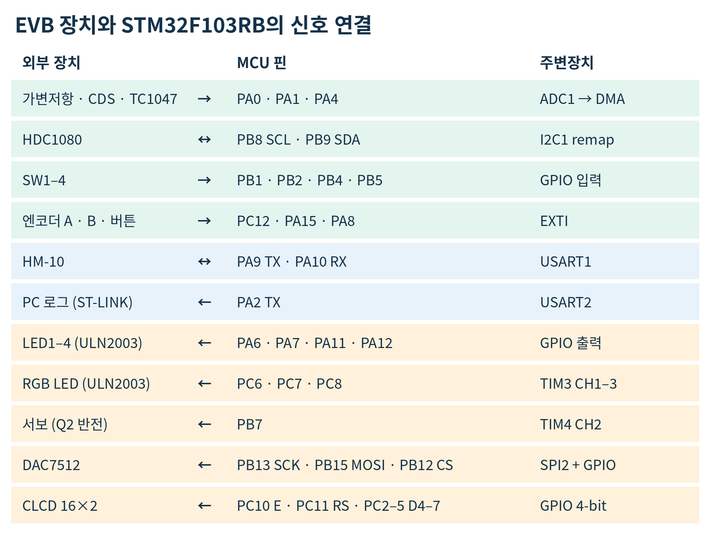
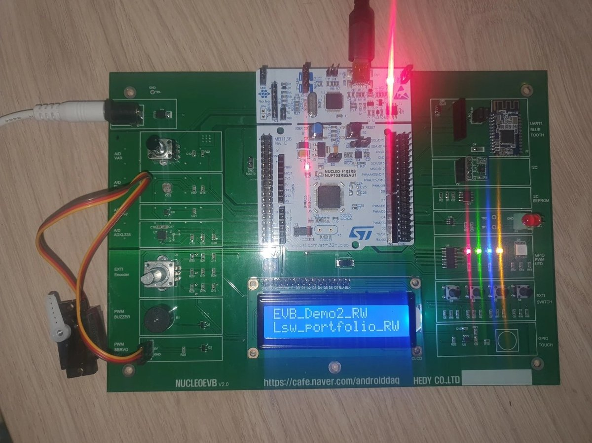

# 02. 하드웨어 구성 및 인터페이스 분석

> **한 줄 요약** — NUCLEO-F103RB를 EVB 보드에 꽂아 썼습니다. MCU는 3.3 V인데 EVB의 CLCD·DAC·LED·서보는 5 V(E5V)로 동작하므로, **"3.3 V 신호로 5 V 소자를 제대로 움직일 수 있는가"**를 각 소자마다 데이터시트로 확인한 것이 이 문서의 핵심입니다.
>
> 근거 표기: **EVB 회로도** = `NUCLEOEVB_v2 (EVB).pdf` (실제 보드에 달린 부품과 연결) · **NUCLEO 회로도** = `mb1136-default-c05_schematic(보드회로).pdf` · **데이터시트** = 부품 제조사 문서 (권장 회로·전기적 사양, 자료 폴더에 없던 것은 제조사 사이트에서 받음) · **코드** = `.ioc`, `main.h`, `stm32f1xx_hal_msp.c` · **[미측정]** = 아직 실측하지 않은 값. 쪽수는 PDF 뷰어 기준입니다.

## 0. 먼저 알아 둘 용어

| 용어 | 쉽게 말하면 | 이 프로젝트에서 |
|---|---|---|
| **VIH** | 받는 칩이 "이건 High다"라고 인정하는 최소 전압 | CLCD(5 V)는 2.2 V, DAC7512(5 V)는 2.4 V 이상이면 High |
| **싱크(sink) 드라이버** | 부하의 아래쪽(GND 쪽)을 대신 연결해 주는 스위치. 입력이 High면 출력이 GND로 연결되어 전류가 흐름 | ULN2003: MCU 핀은 신호만 주고, LED 전류는 5 V → 저항 → LED → ULN2003 → GND로 흐름 |
| **NPN 트랜지스터 + 풀업** | 베이스에 High를 주면 컬렉터가 GND로 붙고, Low면 풀업 저항이 컬렉터를 5 V로 올림. **출력이 입력과 반대**가 됨 | 서보 신호: PB7 → Q2 → 10 kΩ 풀업(5 V) |
| **RC 필터** | 저항과 커패시터로 아주 짧은 튐(노이즈·채터링)을 걸러 내는 회로 | 스위치, 엔코더, ADC 입력마다 달려 있음 |
| **DMA** | CPU 대신 데이터를 옮겨 주는 하드웨어. CPU는 결과만 읽으면 됨 | ADC 변환 결과 → `ADC_value[]` 배열 |
| **PWM** | 일정 주기 안에서 High 시간 비율(듀티)을 바꿔 밝기·각도를 조절 | RGB LED 밝기, 서보 각도 |

## 1. 보드 구성

| 구분 | 내용 | 근거 |
|---|---|---|
| MCU 보드 | NUCLEO-F103RB | — |
| 확장 보드 | NUCLEO EVB v2 (모르포 커넥터 CN1/CN2로 NUCLEO와 연결) | EVB 회로도 p.1 |
| 전원 레일 | **+3V3** (MCU·센서), **AVDD** (아날로그 센서), **E5V** (CLCD·DAC·LED·서보·부저) | EVB 회로도 p.1~4 |
| 외부 전원 | DC 잭 7~12 V / 1 A → 다이오드 SS24 → VIN | EVB 회로도 p.1 |

> **E5V 공급 경로:** EVB 회로도에서 E5V는 NUCLEO의 CN1-6(E5V 핀)과 연결됩니다 (EVB 회로도 p.1). NUCLEO 회로도에서 E5V는 **VIN을 5 V 레귤레이터 LD1117S50TR로 낮춘 출력**입니다 (NUCLEO 회로도 p.2). 그래서 **EVB의 DC 잭(→ VIN)에 전원을 넣어야** E5V가 생기고 CLCD·DAC·LED·서보가 동작합니다.
>
> 이전 판에서는 "회로도만으로 확정하지 못함"이라고 썼는데, NUCLEO 회로도를 확인해 공급 경로를 확정했습니다. 실제 전압값만 **[미측정]** → 멀티미터로 EVB의 E5V–GND 전압을 재면 DAC 출력 계산(3-3절)도 확정됩니다.

## 2. MCU 핀 할당표

| 핀 | 기능 | 연결 대상 (EVB 회로도 넷 이름) | 근거 |
|---|---|---|---|
| PA0 | ADC1_IN0 | 가변저항 VR2 100 kΩ (AVDD) | p.1 CN1-28, p.4 |
| PA1 | ADC1_IN1 | 조도 센서 CDS + 1.5 kΩ (분압) | p.1 CN1-30, p.4 |
| PA4 | ADC1_IN4 | 온도 센서 TC1047 VOUT | p.1 CN1-32, p.4 |
| PA2 / PA3 | USART2 TX / RX | ST-LINK 가상 COM (PC 로그) | `.ioc` |
| PA9 / PA10 | USART1 TX / RX | HM-10 블루투스 (헤더 P12 경유) | p.1 CN2-21/33, p.2 |
| PB8 / PB9 | I2C1 SCL / SDA (**remap**) | 온습도 센서 HDC1080 (헤더 P2) | p.1 CN2-3/5, p.2, `msp.c` `__HAL_AFIO_REMAP_I2C1_ENABLE` |
| PB13 / PB15 / PB12 | SPI2 SCK / MOSI / CS | DAC7512 SCLK / DIN / SYNC | p.1 CN2-30/26/16, p.2 |
| PC10 / PC11 | CLCD E / RS | CLCD16X2 | p.1 CN1-1/2, p.2 |
| PC2 / PC3 / PC4 / PC5 | CLCD D0~D3 → LCD의 **D4~D7** | CLCD16X2 (4-bit 모드) | p.1, p.2 |
| PA6 / PA7 / PA11 / PA12 | LED1~4 (GPIO_LED0~3) | ULN2003 → LED R / G / B / Y | p.1 CN2-13/15/14/12, p.3 |
| PC6 / PC7 / PC8 | TIM3 CH1 / CH2 / CH3 (**remap**) | ULN2003 → RGB LED | p.1, p.3, `msp.c` `__HAL_AFIO_REMAP_TIM3_ENABLE` |
| PB7 | TIM4 CH2 | Q2 → 서보모터 신호 (헤더 P3) | p.1 CN1-21, p.4 |
| PC12 / PA15 | EXTI12 / EXTI15 | 엔코더 A / B | p.1, p.4 |
| PA8 | EXTI8 | 엔코더 스위치 | p.1 CN2-23, p.4 |
| PB1 / PB2 / PB4 / PB5 | GPIO 입력 | 택트 스위치 SW1~4 | p.1, p.3 |
| PA13 / PA14 | SWDIO / SWCLK | 디버거 | `.ioc` |

**JTAG 비활성화가 필요한 이유:** PA15와 PB4는 리셋 직후 JTAG 핀(JTDI, NJTRST)입니다. `stm32f1xx_hal_msp.c`의 `__HAL_AFIO_REMAP_SWJ_NOJTAG()`로 JTAG를 끄고 SWD만 남겨야 엔코더 B(PA15)와 SW3(PB4)를 일반 GPIO로 쓸 수 있습니다 (RM0008 9.3.5 JTAG/SWD alternate function remapping).

**EVB에 있지만 이 프로젝트에서 쓰지 않는 소자:** I2C2 EEPROM AT24C16, 터치 센서 AT42QT1012(PC9), 가속도 센서 ADXL335(IN8/10/11), 부저(TIM4 CH1), WiFi 헤더 P11.

## 3. 소자별 회로와 레벨 확인

### 3-1. HM-10 블루투스 (USART1)

| 항목 | 내용 | 근거 |
|---|---|---|
| 전원 | +3V3 (C4 4.7 µF) | EVB 회로도 p.2 |
| 연결 | MCU TX/RX ↔ HM-10 UART_RX/TX, 헤더 **P12(2×2)**를 거침 (외부 WiFi 헤더 P11과 선택) | EVB 회로도 p.2 |
| 리셋 | NRST와 WIFI_RST를 AND 게이트(SN74LVC1G08)로 묶은 RST | EVB 회로도 p.2 |
| 속도 | 9600 bps | 코드 `MX_USART1_UART_Init` |

- MCU와 같은 3.3 V라 레벨 변환이 필요 없습니다.
- **모듈 이름:** AT 명령 `AT+NAME[이름]`으로 바꿀 수 있고 최대 12글자입니다 (HM-10 AT 명령 문서 `iBeacon_en.pdf` p.13). 이 보드는 `LSW_EVBBoard`(12글자)로 바꿔, 앱 검색 목록에서 이 이름으로 찾습니다.
- **9600 bps:** 위 AT 명령 문서에는 보레이트 항목이 없어 문서로는 확인하지 못했습니다. 코드 설정값이며, **앱과 실제로 통신된 것으로 동작은 확인됨** (06 문서). 이전 판의 "HM-10 데이터시트 없음"은 AT 명령 문서를 확인한 뒤 이렇게 고쳤습니다.

### 3-2. CLCD 16×2 (5 V, GPIO 4-bit)

| 항목 | 내용 | 근거 |
|---|---|---|
| 전원 | VDD = E5V, 대비(VEE) = 가변저항 VR1 100 kΩ, 백라이트 E5V → 1N4007 → A | EVB 회로도 p.2 |
| R/W | **GND에 고정 → 항상 쓰기 모드** | EVB 회로도 p.2 |
| 데이터 | MCU 4선(PC2~PC5) → LCD D4~D7, D0~D3은 미사용 | EVB 회로도 p.2, HD44780U 데이터시트 p.22 |
| 입력 High 기준 | VCC 4.5~5.5 V일 때 **VIH1 = 2.2 V** (최소) | HD44780U 데이터시트 p.51 |

- **3.3 V로 5 V LCD를 움직여도 되는 이유:** LCD가 High로 인정하는 기준이 2.2 V라서 MCU의 3.3 V High로 충분합니다 (여유 1.1 V).
- **LCD 쪽 5 V가 MCU로 들어오지 않는 이유:** R/W가 GND로 고정되어 LCD는 데이터 핀을 출력으로 바꾸지 않습니다. 그래서 MCU 핀에 5 V가 걸릴 일이 없습니다.
- 대신 LCD의 Busy 플래그를 읽을 수 없으므로, 드라이버(`clcd.c`)는 명령마다 정해진 시간만큼 기다립니다 (일반 명령 37 µs, Clear 1.52 ms — HD44780U 데이터시트 p.24).

### 3-3. DAC7512 (5 V, SPI2)

| 항목 | 내용 | 근거 |
|---|---|---|
| 전원 | VDD = E5V | EVB 회로도 p.2 |
| 출력 | VOUT → R3 1 kΩ + C3 100 nF (RC 필터) → 단자 P1, 테스트 포인트 TP1/TP2 | EVB 회로도 p.2 |
| 출력 전압 | **VOUT = VDD × D / 4096** (기준 전압 = 전원 전압) | DAC7512 데이터시트 p.11 |
| 입력 High 기준 | VDD 5 V일 때 **VINH = 2.4 V** (최소) | DAC7512 데이터시트 p.3 |
| 데이터 읽는 시점 | SCLK **하강 에지**에서 DIN을 읽음, 16번째 하강 에지에 출력 갱신 | DAC7512 데이터시트 p.2, p.12 |
| 최대 클럭 | VDD 3.6~5.5 V에서 30 MHz | DAC7512 데이터시트 p.4 |

- **3.3 V SPI로 5 V DAC를 움직여도 되는 이유:** 입력 High 기준이 2.4 V라서 3.3 V로 충분합니다 (여유 0.9 V).
- **SPI 모드:** 코드는 CPOL = 0, CPHA = 1(2nd edge) → 클럭이 올라갈 때 MCU가 데이터를 바꾸고, 내려갈 때 DAC가 읽습니다. 데이터시트의 "하강 에지에서 읽음"과 맞습니다. 데이터시트의 68HC11 연결 예시도 CPOL = 0, CPHA = 1입니다 (p.13).
- **출력 전압 주의:** 기준 전압이 E5V이므로 D = 4095일 때 출력은 약 5 V입니다. 코드의 디버그 출력은 3.3 V 기준으로 계산하고 있어 실제와 다릅니다 → [05 문서](05_troubleshooting.md) 이슈로 정리.

### 3-4. 서보모터 (5 V, TIM4 PWM → 트랜지스터 Q2)

| 항목 | 내용 | 근거 |
|---|---|---|
| 회로 | PB7(TIM4_CH2) → Q2 베이스, Q2 컬렉터에 **R28 10 kΩ 풀업(E5V)** → 헤더 P3 신호선 | EVB 회로도 p.4 |
| 서보 전원 | E5V | EVB 회로도 p.4 |
| 서보 사양 | 주기 약 20 ms, 펄스 폭 500~2400 µs, 회전 범위 180° | SG90 데이터시트 p.2 |

- **트랜지스터를 쓰는 이유 (레벨 변환):** MCU의 3.3 V 신호를 서보가 쓰는 5 V 신호로 바꿉니다. Q2가 꺼지면 10 kΩ 풀업이 신호선을 5 V로 올립니다.
- **출력이 뒤집히는 문제와 해결:** NPN 트랜지스터는 입력이 High일 때 출력이 Low가 되어 **신호가 반대로** 나갑니다. 코드는 TIM4 채널 극성을 **`TIM_OCPOLARITY_LOW`**로 설정해 MCU 핀에서 미리 한 번 뒤집어 보내므로, 서보에는 원래 모양의 펄스가 도착합니다 (`main.c` `MX_TIM4_Init`). **회로를 보고 소프트웨어로 보정한 부분**입니다.
- 실제로 꽂은 서보는 **SG90**입니다 (회로도 메모의 "TowerPro MG90S"와 다름). 코드의 펄스 범위 550~2360 µs는 SG90 사양 500~2400 µs 안에 있습니다 (SG90 데이터시트 p.2).

### 3-5. LED 4개와 RGB LED (5 V, ULN2003 싱크)

| 항목 | 내용 | 근거 |
|---|---|---|
| 구동 IC | ULN2003 (달링턴 트랜지스터 7개, 입력 High → 출력 GND 연결) | EVB 회로도 p.3 |
| LED 4개 | E5V → 저항 → LED → ULN2003 O0~O3. 저항: R 1 kΩ, G 200 Ω, B 4.7 kΩ, Y 470 Ω | EVB 회로도 p.3 |
| RGB LED | E5V → LED(LN03302) → 1 kΩ(R12~R14) → ULN2003 O4~O6 | EVB 회로도 p.3 |
| 입력 기준 | ULN2003의 ON 입력 전압은 IC = 200 mA에서 최대 2.4 V | ULN2003 데이터시트 Table 4 p.6 |

- **ULN2003을 쓰는 이유:** LED 전류를 MCU 핀이 직접 내보내지 않고, 5 V에서 ULN2003을 거쳐 GND로 흐르게 합니다. MCU는 3.3 V로 ON/OFF 신호만 줍니다.
- **3.3 V로 충분한 이유:** 데이터시트의 ON 입력 전압 2.4 V는 200 mA를 흘릴 때 기준이고, LED 전류는 수 mA라 3.3 V High로 충분히 켜집니다.
- **동작 극성:** 핀이 High → LED ON. 코드도 `GPIO_PIN_SET` = 켜짐으로 사용합니다.

### 3-6. 아날로그 센서 (ADC1, AVDD)

| 센서 | 회로 | 근거 |
|---|---|---|
| 가변저항 VR2 | AVDD–GND 사이 100 kΩ, 가운데 → 100 Ω + 10 nF → PA0 | EVB 회로도 p.4 |
| 조도 CDS | AVDD → 1.5 kΩ(R27) → PA1 → CDS → AGND. **어두우면 CDS 저항이 커져 PA1 전압이 올라감** | EVB 회로도 p.4 |
| TC1047 | VDD = AVDD, VOUT → 10 nF → PA4 | EVB 회로도 p.4 |

- **조도 값 방향:** CDS가 아래쪽에 있어서 밝을수록 ADC 값이 작아집니다. 앱에서 값을 해석할 때 이 방향을 고려해야 합니다.
- **조도 센서 부품명:** EVB 회로도에는 부품명 없이 "CDS"로만 적혀 있습니다 (EVB 회로도 p.4). 그래서 자료 폴더의 GL5537 데이터시트는 이 보드의 근거로 쓰지 않았습니다.
- **TC1047 온도 계산:** EVB에 달린 부품은 **TC1047A**입니다 (EVB 회로도 p.4 `TC1047AVNBTR`). 데이터시트의 출력식은 **VOUT = 10 mV/°C × 온도 + 500 mV**이고 (TC1047A 데이터시트 DS21498D p.4, Figure 4-1), 코드는 이 식을 거꾸로 풀어 `(ADC / 4096 × 3.3 − 0.5) × 100`으로 계산합니다.
- **TC1047A 사양:** 측정 범위 −40~125 °C, 정확도 25 °C에서 최대 ±2 °C, 전원 2.5~5.5 V (TC1047A 데이터시트 DS21498D p.1). 이 데이터시트는 자료 폴더에 없어 Microchip 공식 사이트에서 받았습니다.
- 각 입력의 10 nF 커패시터는 ADC 샘플링 순간 전압이 흔들리지 않게 잡아 줍니다.

### 3-7. HDC1080 온습도 센서 (I2C1)

| 항목 | 내용 | 근거 |
|---|---|---|
| 모듈 | BH-002-00 온습도 센서 모듈, 헤더 P2(3V3 / SCL / SDA / GND) | EVB 회로도 p.2 |
| 주소 | 7-bit `1000000` = 0x40 | HDC1080 데이터시트 p.10 |
| 최대 속도 | 400 kHz (코드도 400 kHz) | HDC1080 데이터시트 p.6 |
| 풀업 저항 | SDA/SCL 모두 **풀업 필요** | HDC1080 데이터시트 p.3 |

- EVB 회로도의 I2C1 선에는 풀업 저항이 그려져 있지 않습니다 (I2C2 EEPROM 쪽에만 1.5 kΩ). 모듈(BH-002-00) 회로도는 자료 폴더에 없음 → **[실측 필요]** 전원을 끈 상태에서 모듈의 SCL–3V3, SDA–3V3 사이 저항을 멀티미터로 재면 확인할 수 있습니다.

### 3-8. 입력 장치 (스위치, 엔코더)

| 장치 | 회로 | 근거 |
|---|---|---|
| 택트 스위치 SW1~4 | +3V3 → **220 kΩ 풀업** → 노드 → 100 Ω → MCU. 노드에 100 nF, 스위치는 노드–GND | EVB 회로도 p.3 |
| 엔코더 A/B | +3V3 → 10 kΩ 풀업(R29/R30) → 10 kΩ(R25/R26) + 10 nF(C13/C14) → MCU | EVB 회로도 p.4 |
| 엔코더 스위치 | +3V3 → 220 kΩ 풀업 → 100 Ω + 100 nF → MCU | EVB 회로도 p.4 |

- **누르지 않으면 High, 누르면 Low**입니다. 코드는 `GPIO_PIN_RESET`(Low)을 "눌림"으로 판정합니다.
- **하드웨어 디바운싱:** 스위치를 뗄 때 커패시터가 220 kΩ을 통해 천천히 충전되므로 (시정수 220 kΩ × 100 nF = 22 ms) 접점이 튀어도 전압이 바로 올라가지 않습니다. 코드는 여기에 100 ms 소프트웨어 디바운싱을 더했습니다.
- **엔코더 필터:** 10 kΩ + 10 nF (시정수 약 0.1 ms)로 접점 노이즈를 거릅니다. 엔코더 데이터시트도 노이즈 감소 필터 사용을 권장합니다 (PEC11R 데이터시트 p.1).
- 핀은 모두 `GPIO_NOPULL`(내부 풀업 안 씀) — 외부 풀업이 이미 있기 때문입니다.

## 4. 전기적 특성 요약

| 항목 | 값 | 근거 |
|---|---|---|
| MCU 클럭 | 64 MHz (HSI/2 × 16) | `SystemClock_Config` |
| ADC 클럭 | 8 MHz (PCLK2 64 MHz ÷ 8) | `RCC_ADCPCLK2_DIV8` |
| I2C1 | 400 kHz | `MX_I2C1_Init` |
| SPI2 | 1 MHz (PCLK1 32 MHz ÷ 32), Mode 1 | `MX_SPI2_Init` |
| USART1 / USART2 | 9600 / 115200 bps | `MX_USART*_Init` |
| TIM3 PWM (RGB) | 약 1.96 kHz (1 MHz ÷ (2 × 255), center-aligned) | `MX_TIM3_Init` |
| TIM4 PWM (서보) | 50 Hz (1 MHz ÷ 20000), 1 count = 1 µs | `MX_TIM4_Init` |
| 3.3 V → 5 V 소자 레벨 | CLCD VIH 2.2 V, DAC7512 VINH 2.4 V, ULN2003 VI(on) ≤ 2.4 V → 모두 3.3 V로 만족 | 각 데이터시트 |
| 서보 신호 | Q2 + 10 kΩ 풀업으로 5 V 펄스, 극성은 TIM 설정으로 보정 | EVB 회로도 p.4, 코드 |
| E5V 실제 전압 | [미측정] | — |
| HDC1080 풀업 저항 | [미측정] | — |

## 5. 하드웨어 확인 체크리스트

- [x] 모든 사용 핀을 EVB 회로도 넷 이름과 `.ioc`로 대조
- [x] CLCD(5 V) 입력 기준 2.2 V < 3.3 V (HD44780U p.51), R/W GND 고정으로 MCU에 5 V 역입력 없음
- [x] DAC7512(5 V) 입력 기준 2.4 V < 3.3 V (DAC7512 p.3), SPI 모드와 데이터시트 에지 일치
- [x] 서보 신호 반전(Q2)을 TIM4 극성 LOW로 보정
- [x] ULN2003 싱크 구동, 핀 High = LED ON
- [x] PA15/PB4 사용을 위한 JTAG 비활성화
- [ ] E5V 실제 전압 (멀티미터)
- [ ] HDC1080 모듈 풀업 저항 (멀티미터)
- [x] 실제 서보 모델 확인 → SG90
