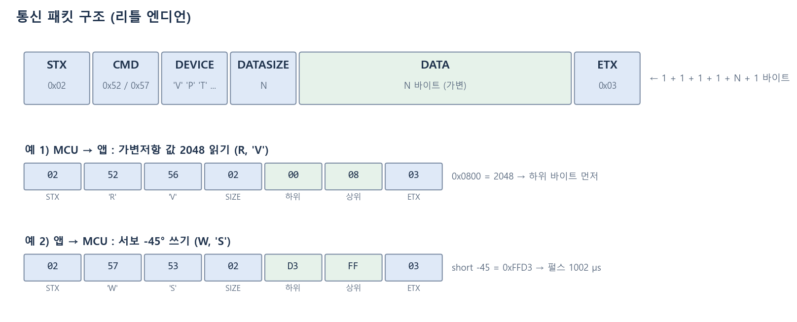

# 04. 핵심 펌웨어 구현 및 동작 원리

## 0. 핵심 구현 요약

1. **바이너리 통신 프로토콜** — STX / CMD / DEVICE / DATASIZE / DATA / ETX 프레임, 리틀 엔디언. 앱과 MCU가 같은 형식으로 R(읽기)·W(쓰기)를 주고받음
2. **인터럽트 기반 수신** — USART1 1바이트 수신 인터럽트에서 STX부터 ETX까지 패킷을 모으고, 완성되면 플래그만 세움. 해석은 메인 루프에서
3. **타이머 기반 송신 스케줄** — TIM2 1 ms 인터럽트로 50 ms마다 R 패킷 1개, 장치 7개를 차례로 돌아가며 송신
4. **ADC + DMA** — 3채널 연속 변환 결과가 CPU 개입 없이 배열에 계속 갱신됨
5. **회로에 맞춘 제어** — 서보 신호 반전 보정(TIM 극성 LOW), DAC7512 16비트 프레임, 엔코더 직교 신호 판정, 스위치 디바운싱

### 소스 구성

| 구분 | 파일 | 작성 |
|---|---|---|
| 직접 작성 | `main.c`의 USER CODE 영역 (프로토콜, 장치 제어, ISR 콜백, `DAC7512_write`) | 개발자 |
| 오픈소스 사용 | `clcd.c/.h` (Tilen Majerle, MIT), `hdc1080.c/.h` (s54mtb) | 외부 + 주석 추가 |
| CubeMX 생성 | `main.c`의 `MX_*_Init`, `SystemClock_Config`, `stm32f1xx_hal_msp.c`, `stm32f1xx_it.c` | ST 도구 |
| ST 라이브러리 | `Drivers/` | ST |

---

## 1. 통신 프로토콜



> 프로토콜 규격(프레임 형식, 장치 문자, 데이터 형식)은 교재 '데모2'의 통신 프로토콜 표를 따랐고, 아래 코드는 그 규격을 구현한 것입니다.

### 1-1. 프레임

| 필드 | 크기 | 값 |
|---|---|---|
| STX | 1 | `0x02` |
| CMD | 1 | `0x52` ('R', MCU → 앱) / `0x57` ('W', 앱 → MCU) |
| DEVICE | 1 | 장치 문자 (아래 표) |
| DATASIZE | 1 | DATA 바이트 수 N |
| DATA | N | 리틀 엔디언 (하위 바이트 먼저) |
| ETX | 1 | `0x03` |

### 1-2. 장치 표

| DEVICE | 장치 | R/W | N | 데이터 형식 |
|---|---|---|---|---|
| `'V'` | 가변저항 | R | 2 | unsigned short (0~4095) |
| `'P'` | 조도 센서 | R | 2 | unsigned short (0~4095) |
| `'T'` | TC1047 온도 | R | 4 | float (−45~125 °C) |
| `'E'` | 엔코더 | R/W | 4 | int |
| `'S'` | 서보모터 | W | 2 | short (−90~90°) — 교재 표는 R/W, 이 구현은 W만 |
| `'I'` | HDC1080 온습도 | R | 4 + 1 | float 온도 + unsigned char 습도 |
| `'D'` | DAC | W | 2 | unsigned short (0~4095) — 교재 표는 R/W, 이 구현은 W만 |
| `'L'` | LED 4개 | R/W | 4 | LED0 → LED1 → LED2 → LED3 순서, 각 1바이트 (0x00 OFF / 0x01 ON) |
| `'M'` | RGB LED | W | 3 | R → G → B 순서, 각 1바이트 unsigned char (0~255) |
| `'R'` | 택트 스위치 | R | 4 | 스위치 4개, 각 1바이트 (0x00 / 0x01) |
| `'1'` / `'2'` | CLCD 1줄 / 2줄 | W | 16 | 문자열 |

> 근거: 교재 '데모2' 〈표 3〉 통신 프로토콜. 원본 표는 교재 저작물이라 저장소에 싣지 않고 위 표로 다시 정리했습니다.

### 1-3. float를 바이트로 보내는 방법

```c
// main.c : float의 비트 패턴을 그대로 32비트 정수로 꺼냄
temp_send = (((float)ADC_value[2] / 4096) * 3.3 - 0.5) * 100;
TC1047_temp_data = *(uint32_t*) &temp_send;

sendbuf[4] = TC1047_temp_data;         // 하위 바이트
sendbuf[5] = TC1047_temp_data >> 8;
sendbuf[6] = TC1047_temp_data >> 16;
sendbuf[7] = TC1047_temp_data >> 24;   // 상위 바이트
```

- float(IEEE 754, 4바이트)를 숫자로 변환하지 않고 **메모리에 있는 비트 그대로** 보냅니다. 앱은 4바이트를 같은 순서로 모아 float로 다시 해석합니다.
- 시프트(`>>`)로 바이트를 나누기 때문에 MCU의 메모리 순서와 상관없이 항상 하위 바이트부터 나갑니다.
- 포인터 형변환 방식은 C 표준의 strict aliasing 규칙에 걸릴 수 있어 `memcpy`가 더 안전합니다 → [05 문서](05_troubleshooting.md) 이슈.

---

## 2. R: MCU → 앱 (타이머 스케줄 송신)

### 2-1. 50 ms 타이머

```c
// main.c : TIM2 1 ms 인터럽트
void HAL_TIM_PeriodElapsedCallback(TIM_HandleTypeDef *htim)
{
    TimerCount++;
    if (TimerCount == 50) { TimerCount = 0; act_mode = 1; }   // 50 ms마다 플래그
}
```

인터럽트 안에서는 플래그만 세우고, 실제 송신(blocking UART)은 메인 루프에서 합니다. ISR을 짧게 유지하기 위해서입니다.

### 2-2. 장치를 돌아가며 1개씩 송신

```c
// main.c : 메인 루프
if (act_mode == 1) {
    act_mode = 0;
    switch (count) {
    case 0:  // 가변저항
        sendbuf = { STX, 'R', 'V', 2, ADC_value[0] 하위, ADC_value[0] 상위, ETX };
        HAL_UART_Transmit(&huart1, sendbuf, 7, 50);
        count++;  break;
    case 1:  // 조도 'P'      case 2: // TC1047 'T'     case 3: // HDC1080 'I'
    case 4:  // 스위치 'R'    case 5: // LED 'L'
    case 6:  // 엔코더 'E' → count = 0
    }
}
```

| 항목 | 값 |
|---|---|
| 패킷 1개 간격 | 50 ms |
| 장치 1개 갱신 주기 | 50 ms × 7 = **350 ms** |
| 패킷 1개 전송 시간 | 7~10바이트 × 1.04 ms = 약 7.3~10.4 ms (9600 bps) |
| 채널 사용률 | 최대 10.4 ms / 50 ms ≈ 21 % → W 패킷이 들어올 여유가 남음 |

**한 번에 다 보내지 않고 나눠 보내는 이유:** 7개 장치를 한꺼번에 보내면 약 60 ms 동안 UART 송신이 이어지고, 그동안 메인 루프는 W 패킷 처리와 스위치 확인을 못 합니다. 50 ms마다 하나씩 보내면 송신 부담이 고르게 나뉩니다.

---

## 3. W: 앱 → MCU (인터럽트 수신 + 메인 루프 해석)

### 3-1. 수신 인터럽트 — 패킷 조립

```c
// main.c : USART1 1바이트 수신 완료 콜백
if (RX_flag1 == 1) {
    // 메인 루프가 이전 패킷을 해석 중 → 버퍼를 덮어쓰지 않도록 버림
} else if (rx_index1 == 0) {
    if (rx_data1 == 0x02) {                                      // STX가 올 때까지 버림
        rx_buffer1[rx_index1++] = rx_data1;
        calculate_cout = 0;                                      // 새 패킷 → 길이 계산 상태 초기화
    }
} else {
    rx_buffer1[rx_index1++] = rx_data1;
    if (rx_index1 >= 4) {                                        // DATASIZE까지 받음
        if (calculate_cout == 0) {
            packet_length = rx_buffer1[3] + 4;                   // ETX가 있어야 할 인덱스
            calculate_cout = 1;
            if (packet_length >= sizeof(rx_buffer1)) { rx_index1 = 0; calculate_cout = 0; }
        }
        if ((calculate_cout == 1) && (rx_index1 == packet_length + 1)) {
            if (rx_buffer1[packet_length] == 0x03) RX_flag1 = 1; // ETX 자리 확인 → 패킷 완성
            else rx_index1 = 0;                                  // 형식 오류 → 다시 STX부터
            calculate_cout = 0;
        }
    }
}
HAL_UART_Receive_IT(&huart1, &rx_data1, 1);                      // 다음 1바이트 수신 재시작
```

- STX 전에 들어온 쓰레기 바이트는 버립니다.
- 패킷 끝은 **0x03 값이 아니라 DATASIZE로 정합니다.** DATA 안에 0x03이 들어 있어도(예: 엔코더 값 3, float의 일부 바이트, 문자열) 잘리지 않습니다.
- ETX는 계산한 자리까지 **다 받은 순간에만** 확인합니다. 그 전에 확인하면 버퍼에 남은 이전 패킷의 0x03을 읽을 수 있습니다.
- 처음에는 "0x03이 오면 끝" 방식이었고, 이 때문에 CLCD 문자열이 표시되지 않는 문제를 겪고 바꿨습니다 → [05 문서](05_troubleshooting.md) 1-1절.

### 3-2. 메인 루프 — 해석과 장치 제어

```c
if (RX_flag1 == 1) {
    // 1) 받은 패킷을 16진수로 PC 로그에 출력
    // 2) STX, 'W' 확인 → 로그
    switch (rx_buffer1[2]) {          // DEVICE
    case 'L':  LED 4개 GPIO 쓰기
    case 'E':  엔코더 카운트 덮어쓰기 + 같은 값을 R 패킷으로 되돌려 보냄(에코)
    case 'S':  servo_pulse = 550 + (각도 + 90) × (2360 − 550) / 180 → TIM4 CCR2
    case 'D':  DAC7512_write(값)
    case 'M':  TIM3 CCR1~3 ← B, R, G
    case '1', '2': CLCD 1줄 / 2줄에 문자열 표시
    }
    rx_index1 = 0;                    // 해석이 끝난 뒤에 수신 재개
    RX_flag1 = 0;                     // (인덱스 먼저, 플래그 나중)
}
```

- 수신 재개(`RX_flag1 = 0`)를 해석이 끝난 뒤에 해서, 해석하는 동안 ISR이 같은 버퍼를 덮어쓰지 않습니다. 이 순서는 RGB 제어가 안 되던 문제를 겪고 정했습니다 → [05 문서](05_troubleshooting.md) 1-2절.

### 3-3. 장치별 변환

| 장치 | 받은 값 → 하드웨어 | 계산 예 |
|---|---|---|
| 서보 | 각도 −90~90 → 펄스 550~2360 µs (TIM4 1 count = 1 µs) | 0° → 550 + 90 × 1810 / 180 = **1455 µs** |
| DAC | 0~4095 → 16비트 프레임 `0b00` + 동작 모드 `00`(Normal) + 12비트 데이터 | 2048 → `0x08 0x00` → VOUT = E5V × 2048 / 4096 (DAC7512 데이터시트 p.11·12) |
| RGB LED | 0~255 → TIM3 CCR (Period 255) | 128 → 듀티 약 50 % |
| LED | 0x01 → `GPIO_PIN_SET` → ULN2003 ON → LED 켜짐 | |

**DAC7512 쓰기 함수 (직접 작성)**

```c
void DAC7512_write(unsigned short data)
{
    uint8_t buff[2];
    HAL_GPIO_WritePin(SPI2_CS_GPIO_Port, SPI2_CS_Pin, GPIO_PIN_RESET);   // SYNC Low → 프레임 시작
    buff[0] = (uint8_t)(data >> 8);     // 상위: [15:14] 무관, [13:12] 모드 00, [11:8] 데이터
    buff[1] = (uint8_t) data;           // 하위: [7:0] 데이터
    HAL_SPI_Transmit(&hspi2, buff, 2, 1000);
    HAL_GPIO_WritePin(SPI2_CS_GPIO_Port, SPI2_CS_Pin, GPIO_PIN_SET);     // SYNC High
}
```

DAC7512는 16번째 SCLK 하강 에지에서 출력을 갱신합니다 (DAC7512 데이터시트 p.12). 값이 4095 이하이면 상위 4비트가 0이라 자동으로 Normal 모드(`00`)가 됩니다 (Table I, p.12).

---

## 4. 입력 처리

### 4-1. 엔코더 (EXTI 인터럽트)

```c
void HAL_GPIO_EXTI_Callback(uint16_t GPIO_Pin)
{
    switch (GPIO_Pin) {
    case ENCODER_SW_Pin: E_count = 0; break;                                   // 누르면 0
    case A_SIG_Pin: if (!HAL_GPIO_ReadPin(B_SIG_GPIO_Port, B_SIG_Pin)) E_count++; break;
    case B_SIG_Pin: if (!HAL_GPIO_ReadPin(A_SIG_GPIO_Port, A_SIG_Pin)) E_count--; break;
    }
}
```

- 엔코더는 A, B 두 신호가 90° 어긋난 직교 신호를 냅니다. **A가 올라가는 순간 B가 Low면 한 방향, B가 올라가는 순간 A가 Low면 반대 방향**으로 판단합니다.
- 상승 에지만 사용하므로 한 주기에 1번 셉니다. EVB의 RC 필터(10 kΩ + 10 nF)가 접점 튐을 줄여 줍니다 ([02 문서](02_hardware.md) 3-8절).

### 4-2. 택트 스위치 (폴링 + 디바운싱)

```c
// 4개 중 하나라도 이전 상태와 다르면
if (debouncing_flag == 0) { debouncing_flag = 1; last_time = 현재 시각; }
else if (현재 시각 - last_time >= 100) {         // 100 ms 동안 바뀐 상태가 유지되면 확정
    debouncing_flag = 0;  이전 상태 = 현재 상태;
    눌린(Low) 스위치 → LED 토글, T_SW[i] = 1
}
```

- 상태가 바뀐 뒤 100 ms가 지나야 확정하므로 접점이 튀어도 한 번만 인식합니다. EVB의 하드웨어 RC(시정수 22 ms)와 함께 이중으로 거릅니다.
- 스위치로 바꾼 LED 상태는 `HAL_GPIO_ReadPin`으로 다시 읽어 R 패킷('L')에 실려 앱에 반영됩니다.

### 4-3. HDC1080 측정

```c
// hdc1080.c : hdc1080_measure
HAL_I2C_Master_Transmit(hi2c, 0x40 << 1, &reg(0x00), 1, 1000);   // 측정 시작
HAL_Delay(15);                                                     // 변환 대기
HAL_I2C_Master_Receive(hi2c, 0x40 << 1, data, 4, 1000);           // 온도 2 + 습도 2바이트
temperature = (raw_t / 65536.0) × 165 − 40;
humidity    = (raw_h / 65536.0) × 100;
```

- 설정 레지스터 bit 12(MODE) = 1이라 온도와 습도를 연속으로 측정합니다. 14비트 변환 시간이 온도 6.35 ms + 습도 6.50 ms = **12.85 ms**이므로 15 ms 대기가 필요합니다 (HDC1080 데이터시트 p.5). 드라이버 주석의 "데이터시트 7 ms로는 값이 틀림"은 두 측정을 더하지 않았기 때문으로 보입니다.
- 이 15 ms 대기는 메인 루프를 매번 멈추게 합니다 → [05 문서](05_troubleshooting.md) 이슈.

---

## 5. printf → UART2

```c
void __io_putchar(int ch)
{
    if (ch == '\n') HAL_UART_Transmit(&huart2, (uint8_t*)"\r", 1, 0xffff);
    HAL_UART_Transmit(&huart2, (uint8_t*)&ch, 1, 0xffff);
}
```

`printf`의 `\n`마다 `\r`을 앞에 붙여 터미널에서 줄이 맞게 보이게 합니다. 디버그 로그는 받은 패킷의 16진수 덤프와 필드별 확인 결과입니다.

```
<!-- 로그 자리: Tera Term에서 W 패킷 수신 로그 캡처 (06 문서 참고) -->
02 57 53 02 D3 FF 03
STX_OK
W_OK
SERVO_OK
DATABYTE_OK
ETX_OK
```

(위 로그는 코드의 `printf` 순서로 구성한 **예시**입니다. 실제 캡처로 교체 예정.)
